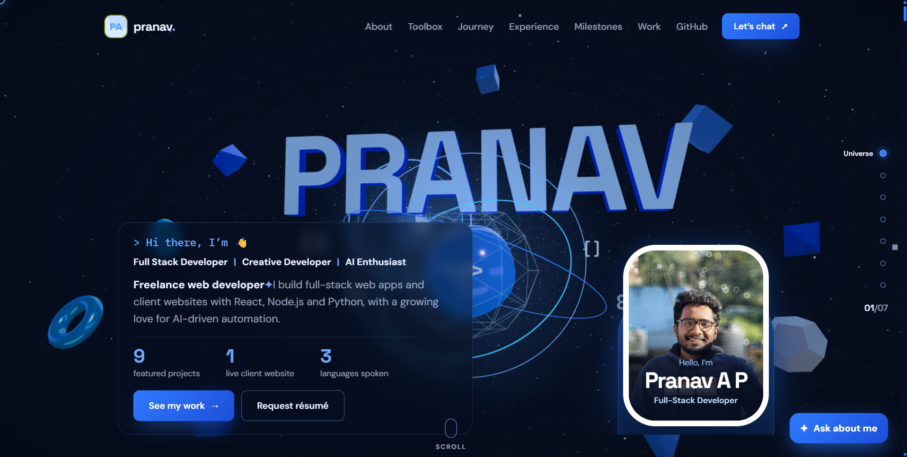
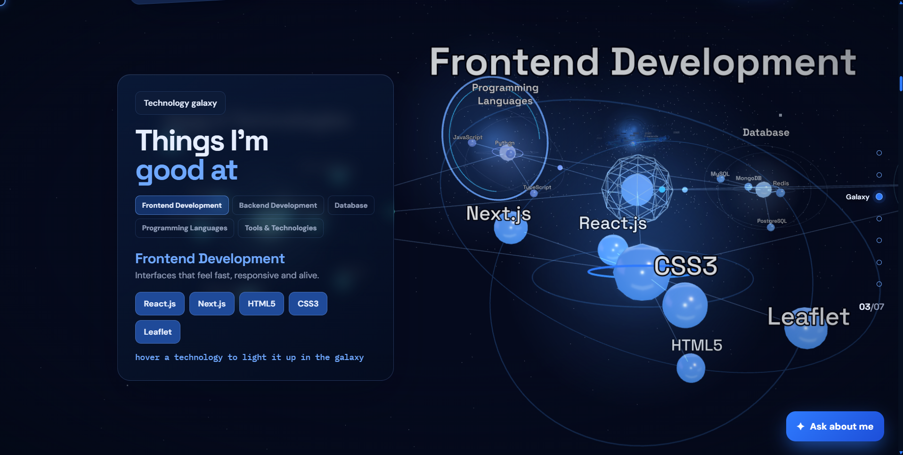
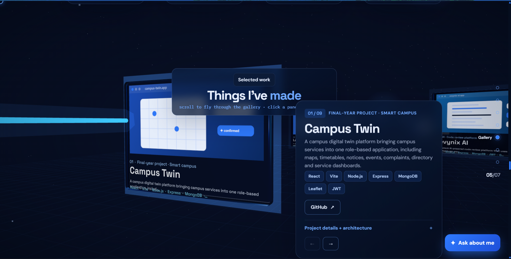
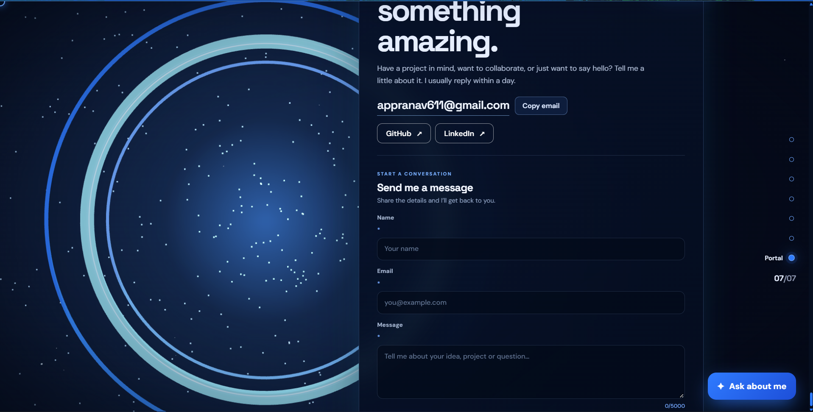

# Pranav A P | Cinematic 3D Developer Portfolio

<p align="center">
  
</p>

<p align="center">
  <strong>An interactive journey through code, creativity and technology.</strong>
  <br />
  A personal developer portfolio built with React, Three.js, React Three Fiber, GSAP and Vite.
</p>

<p align="center">
  <a href="YOUR_LIVE_PORTFOLIO_URL">
    
  </a>
  <a href="https://github.com/pranavap2026-ship-it">
    
  </a>
  <a href="https://www.linkedin.com/in/pranav-a-p-b52b15290?utm_source=share_via&utm_content=profile&utm_medium=member_android">
    
  </a>
</p>

<p align="center">
  
  
  
  
  
  
</p>

---

## About Me

Hi! I'm **Pranav A P**, a Computer Science and Engineering student and Full-Stack Developer passionate about building modern web applications, interactive digital experiences and practical software solutions.

I enjoy exploring the intersection of frontend engineering, backend development, 3D visualization and emerging technologies.

My development interests include:

- Full-Stack Web Development
- React and Modern JavaScript
- Node.js and Express
- MongoDB and Database Design
- Interactive 3D Web Experiences
- AI-Powered Applications
- UI/UX Engineering

This portfolio represents my approach to web development: combining functionality, performance, creativity and thoughtful engineering into a single experience.

---

## About This Project

**A portfolio beyond the traditional scrolling website.**

This project transforms a personal developer portfolio into an immersive cinematic 3D experience.

Instead of presenting information through conventional static sections, visitors travel through seven interconnected 3D environments using a scroll-controlled camera system.

Each environment represents a different part of my professional identity, including my introduction, workspace, technical skills, journey, projects, GitHub activity and contact information.

The experience combines:

- Real-time 3D rendering.
- Scroll-driven camera animation.
- Interactive 3D environments.
- Smooth scrolling and transitions.
- Responsive DOM-based interfaces.
- Performance-conscious rendering.
- Accessible content and navigation.

**The objective is simple: make exploring a developer portfolio as interesting as building one.**

---

## Experience — Seven Connected 3D Environments

The portfolio consists of seven interconnected scenes controlled through one continuous camera journey.

### 01 — Universe

<p align="center">
  
</p>

The opening environment introduces my developer identity through an immersive 3D universe.

**Features:**
- Floating 3D geometry.
- Interactive visual elements.
- Code-inspired floating glyphs.
- Cursor-based parallax.
- Cinematic lighting and atmosphere.

### 02 — Workspace

A virtual developer workspace presenting my personal information and introduction.

**Features:**
- Floating workspace environment.
- Profile information.
- Interactive photography stack.
- 3D visual composition.

### 03 — Technology Galaxy

<p align="center">
  
</p>

An interactive visualization of my technical skills through five connected technology clusters.

**Features:**
- Five skill clusters.
- Animated connections.
- Floating 3D elements.
- Technology-focused visual organization.

### 04 — Journey

A curved 3D pathway representing my learning and professional development.

**Features:**
- 3D journey pathway.
- Education timeline.
- Experience information.
- Certifications.
- Scroll-synchronized content.

### 05 — Project Gallery

<p align="center">
  
</p>

A cinematic project showcase displaying selected development work.

**Features:**
- 3D project presentation.
- Project descriptions.
- Technology information.
- Live project links where available.
- Data-driven project content.

### 06 — GitHub Activity

A dedicated environment representing my development activity and open-source presence.

**Features:**
- Public repository information.
- Recent public GitHub activity visualization.
- Developer-focused presentation.

### 07 — Contact Portal

<p align="center">
  
</p>

The final environment provides a connection point for recruiters, developers, collaborators and visitors.

**Features:**
- Contact information.
- Email enquiry form.
- Web3Forms integration.
- Copy email functionality.
- GitHub and professional social links.
- Responsive contact interface.

---

## Technology Stack

The project uses modern frontend technologies and real-time 3D rendering libraries.

### Frontend

| Technology | Purpose |
|---|---|
| React | Component-based UI development |
| JavaScript ES6+ | Application logic |
| HTML5 | Semantic structure |
| CSS3 | Styling and responsive layouts |
| Vite | Development server and build tooling |

### 3D Development

| Technology | Purpose |
|---|---|
| Three.js | Real-time 3D rendering |
| React Three Fiber | React renderer for Three.js |
| 3D Camera Systems | Camera movement and interpolation |
| WebGL | Hardware-accelerated rendering |
| 3D Materials and Lighting | Environment composition |

### Animation and Interaction

| Technology | Purpose |
|---|---|
| GSAP | Animation orchestration |
| GSAP ScrollTrigger | Scroll-based animation |
| Lenis | Smooth scrolling |
| React Hooks | Component state and lifecycle management |

### Integrations

| Technology | Purpose |
|---|---|
| GitHub API | Public repository and activity information |
| Web3Forms | Contact form email delivery |
| Clipboard API | Copy email functionality |

---

## System Architecture

A major engineering aspect of this project is the centralized 3D architecture.

Rather than creating an independent WebGL canvas for every section, the portfolio uses a **single shared React Three Fiber Canvas** to manage the entire 3D experience.

This allows the different environments to participate in one continuous camera journey.

### Project Structure

```text
portfolio/
│
├── public/
│   ├── img/
│   │   └── projects/
│   │
│   ├── readme/
│   │   ├── hero.png
│   │   ├── universe.png
│   │   ├── technology-galaxy.png
│   │   ├── project-gallery.png
│   │   └── contact-portal.png
│   │
│   └── ...
│
├── src/
│   │
│   ├── components/
│   │   ├── DOM sections
│   │   ├── Navigation
│   │   ├── Contact
│   │   └── Interface components
│   │
│   ├── three/
│   │   ├── scenes/
│   │   │   ├── Universe
│   │   │   ├── Workspace
│   │   │   ├── Technology Galaxy
│   │   │   ├── Journey
│   │   │   ├── Project Gallery
│   │   │   ├── GitHub Activity
│   │   │   └── Portal
│   │   │
│   │   ├── World.jsx
│   │   ├── config.js
│   │   └── util.js
│   │
│   ├── lib/
│   │   ├── director.js
│   │   ├── motion.js
│   │   └── store.js
│   │
│   ├── styles/
│   │   └── Global and scene styles
│   │
│   └── data.js
│
├── .env.example
├── .gitignore
├── index.html
├── package.json
├── package-lock.json
├── vite.config.js
└── README.md
```

---

## Scroll-Driven Camera Architecture

The portfolio uses a centralized scroll synchronization system to connect DOM scrolling with the 3D camera.

### How It Works

```text
           User Scroll
                |
                v
          Lenis Smooth Scroll
                |
                v
         GSAP ScrollTrigger
                |
                v
           director.js
                |
                v
          Shared Store
                |
                v
          config.js
                |
                v
       Camera Keyframe Mapping
                |
                v
           World.jsx
                |
                v
        Shared 3D Camera Rig
                |
                v
        Seven 3D Environments
```

### Core Responsibilities

**Lenis**
- Provides smooth scrolling.
- Synchronizes scrolling with animation updates.

**GSAP ScrollTrigger**
- Tracks scroll progress.
- Coordinates scroll-based animation.

**director.js**
- Measures scene and camera keyframe positions.
- Updates shared progress information.

**store.js**
- Shares animation state between DOM and 3D components.

**config.js**
- Defines scene layout and camera keyframes.
- Stores camera positions and transitions.

**World.jsx**
- Manages the shared Canvas.
- Handles camera interpolation.
- Coordinates 3D scene rendering.

This architecture creates a continuous visual experience while keeping the interface and 3D rendering logically separated.

---

## Key Features

| Feature | Description |
|---|---|
| Cinematic 3D | Seven interconnected environments |
| Scroll Animation | Camera movement synchronized with scrolling |
| Interactive Elements | Cursor-based and 3D interactions |
| Smooth Navigation | Lenis and GSAP integration |
| Dynamic Content | Data-driven portfolio sections |
| Project Showcase | Interactive project presentation |
| GitHub Integration | Public repository activity |
| Contact System | Email enquiry integration |
| Responsive UI | Desktop, tablet and mobile layouts |
| Accessibility | DOM content and reduced-motion support |

---

## Performance and Accessibility

The portfolio is designed to balance visual quality with usability.

### Performance

- One shared WebGL Canvas.
- Lazy-loaded 3D scene modules.
- Adaptive device pixel ratio.
- Quality adjustments for smaller devices.
- Reduced particle counts on mobile.
- Shared 3D resources where practical.
- Efficient scene management.

### Accessibility

- Semantic DOM content.
- Keyboard focus styling.
- Reduced-motion preference support.
- Accessible navigation.
- DOM fallback when WebGL is unavailable.

The 3D environment enhances the experience without making essential portfolio information dependent on WebGL.

---

## Getting Started

Follow these instructions to run the project locally.

### Prerequisites

Make sure you have installed:

- Node.js 20.19+ or 22.12+
- npm
- Git
- A modern browser with WebGL support

### 1. Clone the Repository

```bash
git clone YOUR_GITHUB_REPOSITORY_URL
```

### 2. Navigate to the Project

```bash
cd your-portfolio-folder
```

### 3. Install Dependencies

```bash
npm install
```

### 4. Configure Environment Variables

Create a `.env.local` file in the project root.

```env
VITE_WEB3FORMS_ACCESS_KEY=your_web3forms_access_key
```

To obtain an access key, visit:

https://web3forms.com/

The contact form uses this key to send portfolio enquiries to your configured email inbox.

**Important:**
- Never commit `.env.local`.
- Keep environment variables out of public source control.
- Configure the same variable in your deployment platform.
- Do not store private SMTP credentials in browser-exposed Vite variables.

### 5. Start the Development Server

```bash
npm run dev
```

Vite will provide a local development URL in the terminal.

---

## Production Build

Generate an optimized production build:

```bash
npm run build
```

Preview the production build locally:

```bash
npm run preview
```

The generated production files will be available inside:

```text
dist/
```

---

## Customization

Most portfolio information is maintained in:

```text
src/data.js
```

You can customize:

- Name and introduction.
- Professional role.
- Location and contact email.
- GitHub profile.
- LinkedIn profile.
- Instagram profile.
- Resume link.
- Projects and descriptions.
- Technology stack.
- Education and journey.
- Certifications.
- Portfolio statistics.

### Updating Project Information

Edit the project data in `src/data.js`.

Add your project title, description, technologies and available links.

### Adding Project Screenshots

Place your screenshots inside:

```text
public/img/projects/
```

Reference the images from the corresponding project data.

### Updating the Visual Theme

Global styling is maintained in:

```text
src/styles/global.css
```

3D scene palettes, camera positions and layout configurations are maintained in:

```text
src/three/config.js
```

---

## Deployment

The project can be deployed using Vercel or Netlify.

### Recommended Configuration

| Setting | Value |
|---|---|
| Framework | Vite |
| Build Command | `npm run build` |
| Output Directory | `dist` |
| Install Command | `npm install` |
| Environment Variable | `VITE_WEB3FORMS_ACCESS_KEY` |

### Deployment Checklist

- Configure the contact form environment variable.
- Verify all project links.
- Test the website on desktop and mobile.
- Verify WebGL rendering.
- Check browser console errors.
- Update canonical URL metadata.
- Update sitemap and robots.txt for the production domain.

---

## Development Highlights

Through this project, I have worked with:

- Component-based frontend architecture.
- React and Three.js integration.
- Shared state between DOM and 3D environments.
- Real-time WebGL rendering.
- Scroll-driven camera animation.
- Camera interpolation and keyframe systems.
- Dynamic 3D scene management.
- Responsive interface engineering.
- External API integration.
- Performance-conscious rendering.
- Accessibility-aware development.
- Production builds and deployment.

This project reflects my interest in combining software engineering with creative frontend development.

---

## Future Enhancements

Areas I would like to explore further:

- Advanced interactive 3D environments.
- More sophisticated camera transitions.
- Further mobile GPU optimization.
- Enhanced project previews.
- Additional interaction and accessibility improvements.
- More detailed performance profiling.

---

## Connect With Me

I'm always interested in connecting with developers, recruiters, founders and people working on interesting technology.

If you're interested in my work, exploring opportunities or discussing a collaboration, feel free to reach out.

<p align="center">
  <strong>Pranav A P</strong>
  <br />
  Full-Stack Developer | B.Tech Computer Science & Engineering
  <br /><br />
  <a href="YOUR_LIVE_PORTFOLIO_URL">Portfolio</a> •
  <a href="https://github.com/pranavap2026-ship-it">GitHub</a> •
  <a href="'https://www.linkedin.com/in/pranav-a-p-b52b15290?utm_source=share_via&utm_content=profile&utm_medium=member_android">LinkedIn</a> •
  <a href="https://www.instagram.com/p.r_a_n_a.v?psln=MWs0dms4dzNkdWdoNQ==">Instagram</a>
  <br /><br />
  <a href="mailto:YOUR_EMAIL">Let's build something amazing.</a>
</p>

---

<p align="center">
  Built with React, Three.js, GSAP and creativity.
  <br />
  © 2026 Pranav A P. All rights reserved.
</p>